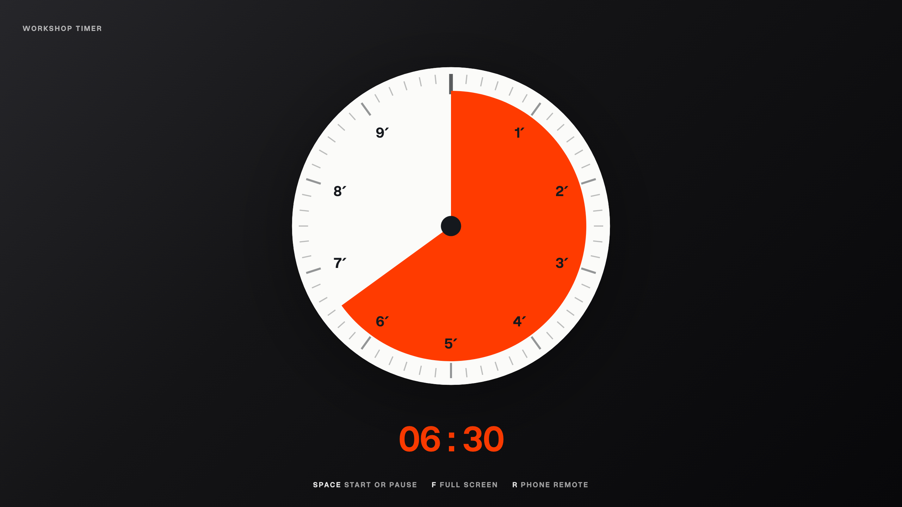
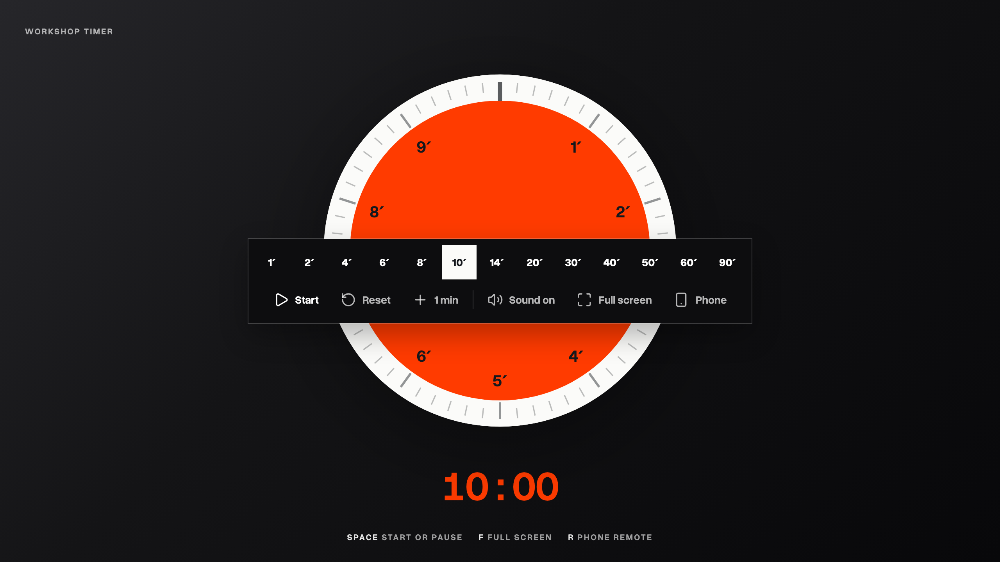
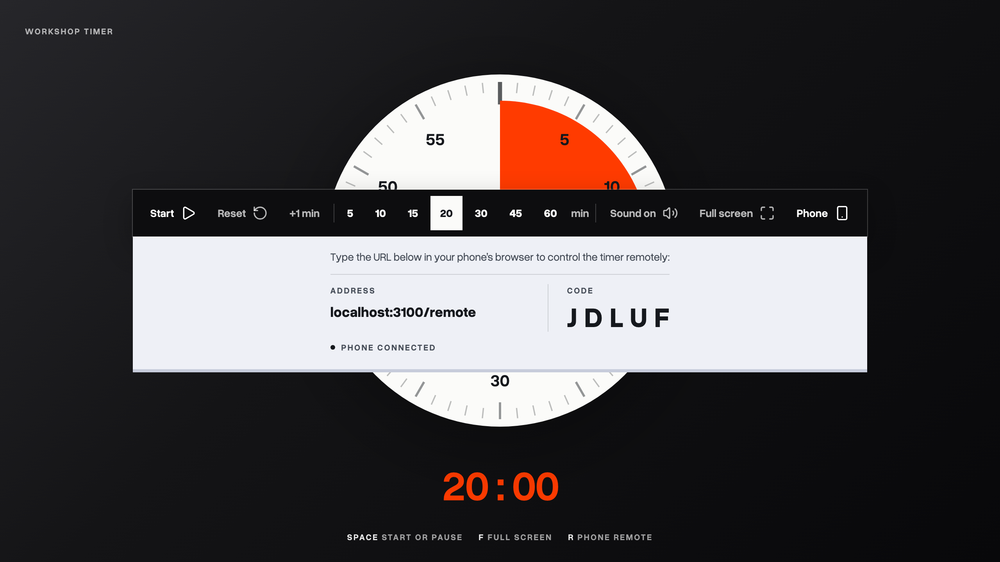
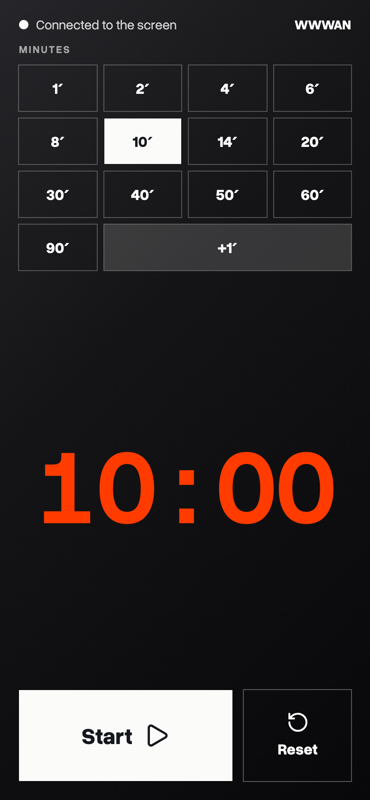
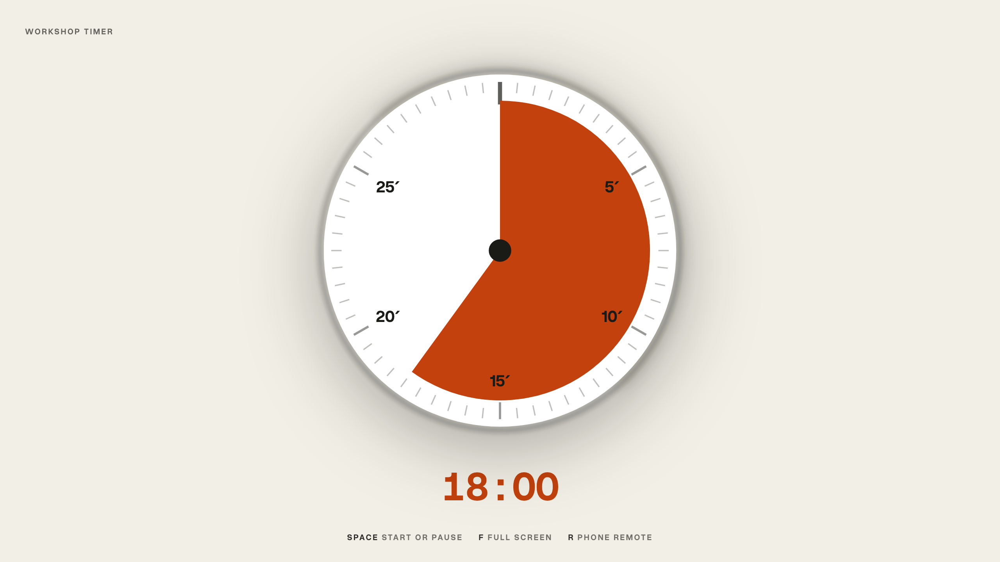
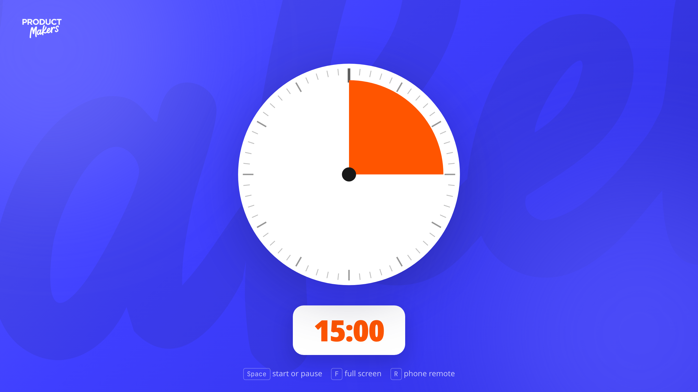

<div align="center">

# workshop-timer

**A workshop countdown timer for facilitators and trainers, with a phone remote. White-label. Make it yours.**

Built for workshops, trainings, hackathons, jams and demo rounds. White label by design. Customize it and make it yours.



</div>

---

## What makes it different

**The dial measures an hour, not a percentage.** Like a kitchen timer, the face
is always one hour and the wedge is the slice of that hour still to come, so
fifteen minutes reads as a quarter turn from the back of the room with nobody
reading a number. The numerals tell you where the edge will land.

**The controls get out of the way.** They appear when you move and leave 2.6
seconds after you stop, taking the mouse pointer with them. On a projector a
parked arrow is as loud as a button.

**It keeps time against a deadline, not a counter.** A browser throttles timers
in a background tab, and a clock that subtracts 100ms per tick quietly loses
minutes while you present in another window. This one recomputes from a wall
clock every tick, so it cannot drift.



Three keys, because the laptop is usually across the room: `Space` to start or
pause, `F` for full screen, `R` for the phone. Set the length by typing into the
readout, by preset, or in the link itself (`/#25`, `/#7:30`).

The last minute switches the readout to hundredths, lights the rim, shakes the
face, ticks each second and strikes a gong at zero. All of it goes quiet under
`prefers-reduced-motion`, and the sound is synthesised, so the app ships no
audio file.

## Drive it from your phone

Press `R`. A receipt feeds out from under the controls with an address and a
five character code. Open that address on a phone, type the code, and either
device drives the clock while both follow.



<table>
<tr>
<td width="230"></td>
<td>

The relay carries **state, not commands**. A reply says how much time is left,
and each side rebuilds its own deadline from that against its own clock. No
absolute timestamp ever crosses the wire, so a phone whose clock is a minute
out cannot retime the room, and a missed poll costs nothing.

The code lives in the phone's URL fragment, so a locked phone or a reloaded tab
reconnects without typing it again. One pairing survives the gong and runs timer
after timer all day.

</td>
</tr>
</table>

## Make it yours

Everything a brand can change is a CSS custom property, so a new brand is a JSON
file and never a patch.



**Ship a brand with the deployment.** Put a file in `brands/` and name it:

```bash
TIMER_BRAND=example                        # reads brands/example.json
TIMER_BRAND=https://acme.com/brand.json    # or fetched once at startup
```

Applied on the server before the first byte: no query string, no flash.

**Or brand it from the URL**, for a one off that is not worth hosting a file
for:

```
/?brand=https://acme.com/brand.json
/?accent=%23ff3b00&ground=%23101010&name=Acme
```

Copy [`brands/example.json`](brands/example.json) to see every field. Three
things are worth knowing:

1. **`face` must be brighter than `ground`.** The dial is read from the back of
   a room and the rim light is light escaping past the face.
2. **`accent` carries the only information on the page.** You do not have to
   protect the readout yourself: the app measures accent against ground and
   drops in a bright plate behind the digits only when contrast falls below
   3:1. It does the same for text set on the ground.
3. **Colours are hex, and only hex.** These values reach a `<style>` element and
   can arrive from a query string, so anything that could carry a semicolon
   could write arbitrary CSS into the page. Hex removes the question.

---

<table>
<tr>
<td width="330"></td>
<td>

### Try it live

The [**Product Makers**](https://productmakers.ro) community adapted this timer
for their trainings and workshops, with full branding and colors. Test it to see
how it works live.

**[Open the timer](https://productmakers.ro/timer.html)**  
Press `R` on the page, then open
**[the remote](https://productmakers.ro/timer.html/remote)** on your phone and
type the code. Two devices, one clock.

Add `#5` to the address for a five minute countdown.

</td>
</tr>
</table>

---

## Running it

```bash
npm install
npm run dev     # http://localhost:3000
```

Node 20.9 or newer. No database, no accounts, no API keys.

## Hosting

**It needs a Node host**, not a static file host. The pairing relay is a server
route, and the pages render per request so `TIMER_BRAND` means what you expect
at runtime. Railway, Render, Fly, a VPS or a container all work.

**Run exactly one instance.** The relay keeps live pairings in memory, which
buys it zero infrastructure and costs it two things, both accepted rather than
overlooked: a deploy drops any pairing in flight, and two instances would put
the screen and the phone on different containers. The countdown on screen never
stops either way, and one press of `R` opens a new room. If you need it to
survive either, keep the shape of the view in `src/lib/timer-room.ts` and change
only where the map lives.

**Framing is allowed from anywhere**, so the clock can live inside Notion, Miro
or a Google Site. `Permissions-Policy` deliberately leaves `fullscreen` and
`screen-wake-lock` alone, because the timer needs both: it keeps the laptop from
blanking halfway through a session.

## Credits

The fade away chrome and the idea of driving a projected screen from a phone
both come from **[html-deck-kit](https://github.com/adyrugina/html-deck-kit)**,
which does them for slide decks. The relay is the deliberate departure: a deck
has no clock, so it relays taps and throws away stale ones; a countdown has one,
so this relays state, and nothing it sends can go stale.

## Licence

MIT, see [LICENSE](LICENSE). Use it, fork it, rebrand it, sell it; just keep the
notice.
